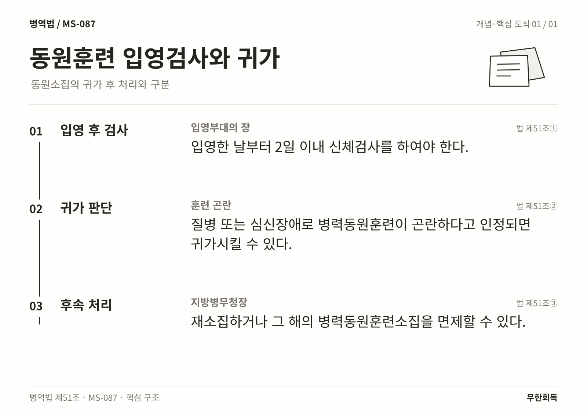

# MS-087 · 병역법 제51조, 병력동원훈련소집 입영신체검사 및 귀가

흑백 편집형 도식 1장 · 1600×1120 · SVG / 무손실 WebP

## 01. 동원훈련 입영검사와 귀가

[강의용 WebP](MS-087-D01-editorial-v1.webp) · [편집용 SVG](MS-087-D01-editorial-v1.svg)

[전체 병역법 도식 목차](../../README.md)
