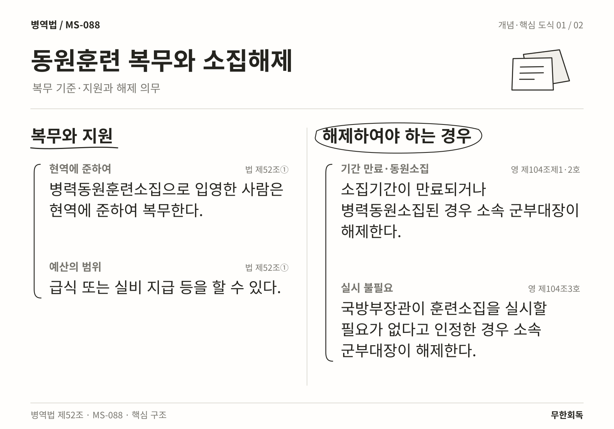
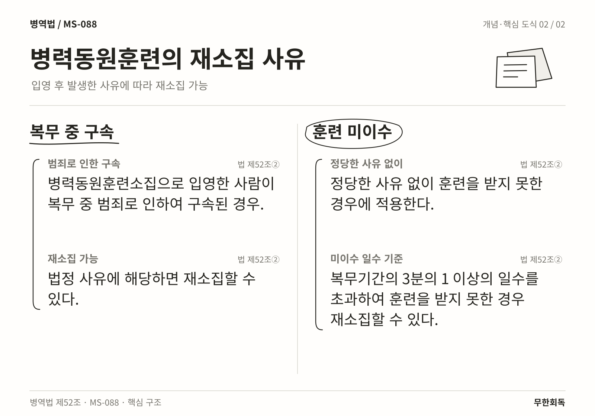

# MS-088 · 병역법 제52조, 병력동원훈련소집된 사람의 복무

흑백 편집형 도식 2장 · 1600×1120 · SVG / 무손실 WebP

## 01. 동원훈련 복무와 소집해제

[강의용 WebP](MS-088-D01-editorial-v1.webp) · [편집용 SVG](MS-088-D01-editorial-v1.svg)

## 02. 병력동원훈련의 재소집 사유

[강의용 WebP](MS-088-D02-editorial-v1.webp) · [편집용 SVG](MS-088-D02-editorial-v1.svg)

[전체 병역법 도식 목차](../../README.md)
