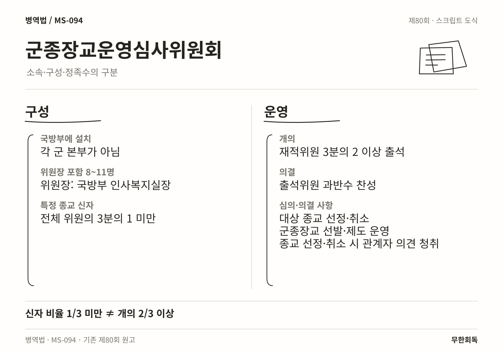
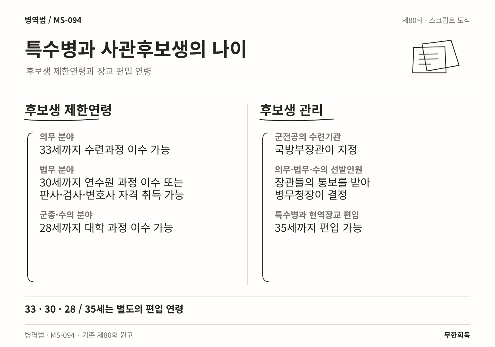
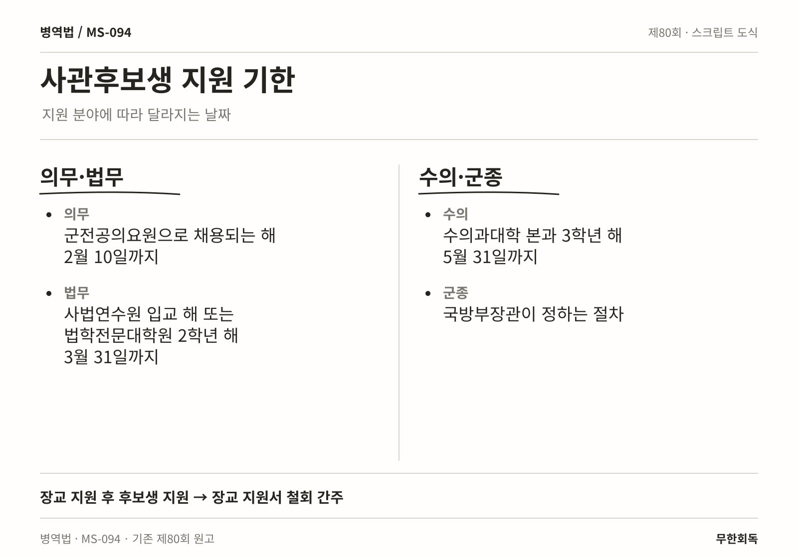
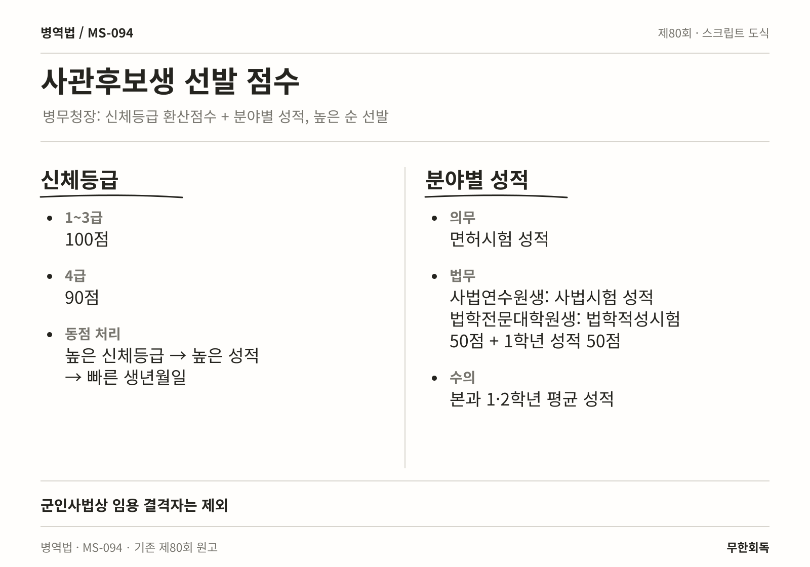
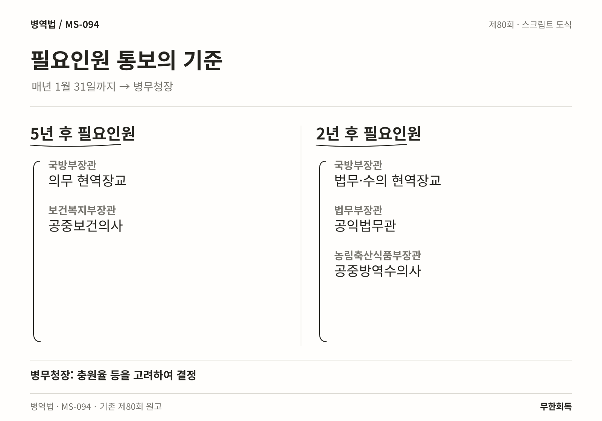

# MS-094 · 병역법 제58조, 의무·법무·군종·수의장교 등의 병적 편입

흑백 편집형 도식 7장 · 1600×1120 · SVG / 무손실 WebP

## 01. 특수병과 현역장교 편입 대상

[강의용 WebP](MS-094-D01-editorial-v1.webp) · [편집용 SVG](MS-094-D01-editorial-v1.svg)

## 02. 특수병과 장교 입영검사와 귀가

[강의용 WebP](MS-094-D02-editorial-v1.webp) · [편집용 SVG](MS-094-D02-editorial-v1.svg)

## 03. 군종장교운영심사위원회

[강의용 WebP](MS-094-D03-editorial-v1.webp) · [편집용 SVG](MS-094-D03-editorial-v1.svg)

## 04. 특수병과 사관후보생의 나이

[강의용 WebP](MS-094-D04-editorial-v1.webp) · [편집용 SVG](MS-094-D04-editorial-v1.svg)

## 05. 사관후보생 지원 기한

[강의용 WebP](MS-094-D05-editorial-v1.webp) · [편집용 SVG](MS-094-D05-editorial-v1.svg)

## 06. 사관후보생 선발 점수

[강의용 WebP](MS-094-D06-editorial-v1.webp) · [편집용 SVG](MS-094-D06-editorial-v1.svg)

## 07. 필요인원 통보의 기준

[강의용 WebP](MS-094-D07-editorial-v1.webp) · [편집용 SVG](MS-094-D07-editorial-v1.svg)

[전체 병역법 도식 목차](../../README.md)
