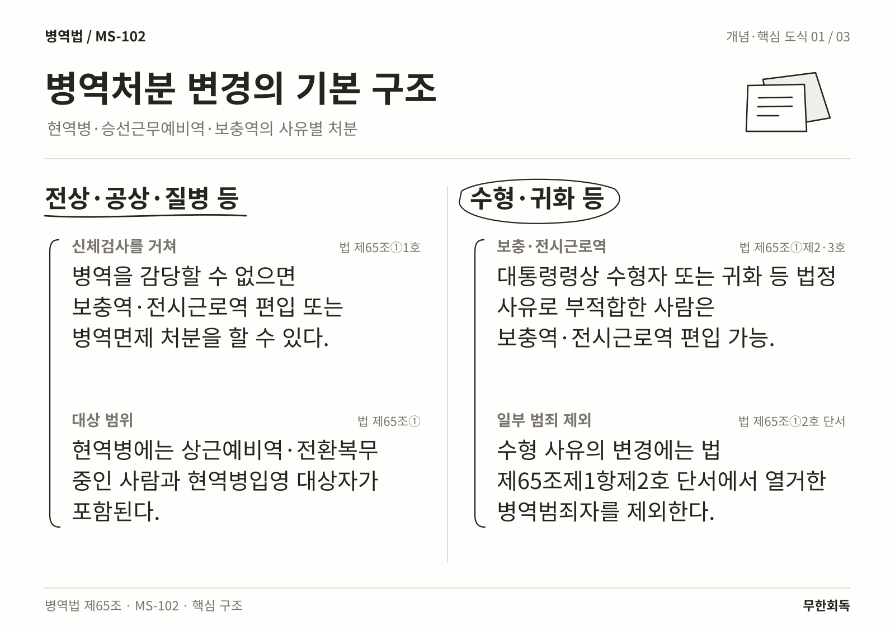
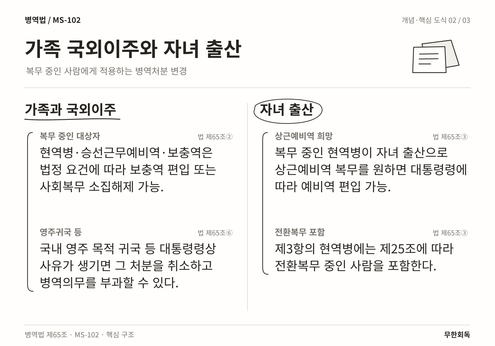
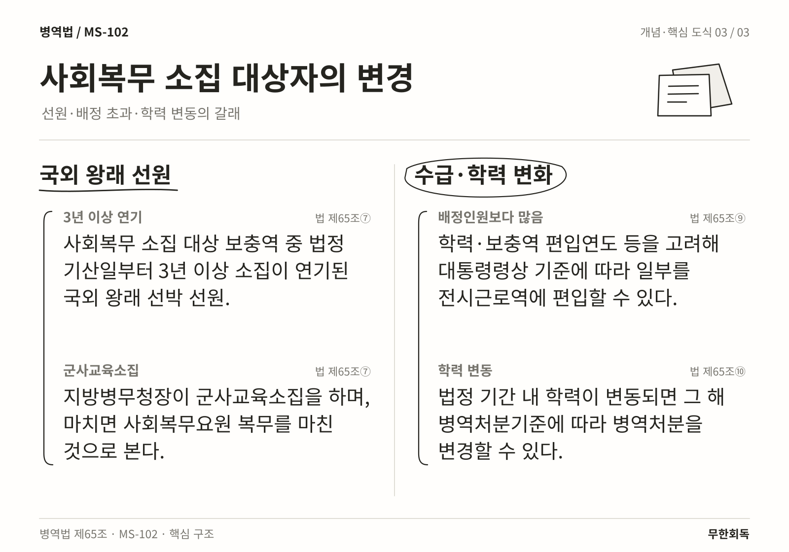

# MS-102 · 병역법 제65조, 병역처분 변경 등

흑백 편집형 도식 3장 · 1600×1120 · SVG / 무손실 WebP

## 01. 병역처분 변경의 기본 구조

[강의용 WebP](MS-102-D01-editorial-v1.webp) · [편집용 SVG](MS-102-D01-editorial-v1.svg)

## 02. 가족 국외이주와 자녀 출산

[강의용 WebP](MS-102-D02-editorial-v1.webp) · [편집용 SVG](MS-102-D02-editorial-v1.svg)

## 03. 사회복무 소집 대상자의 변경

[강의용 WebP](MS-102-D03-editorial-v1.webp) · [편집용 SVG](MS-102-D03-editorial-v1.svg)

[전체 병역법 도식 목차](../../README.md)
