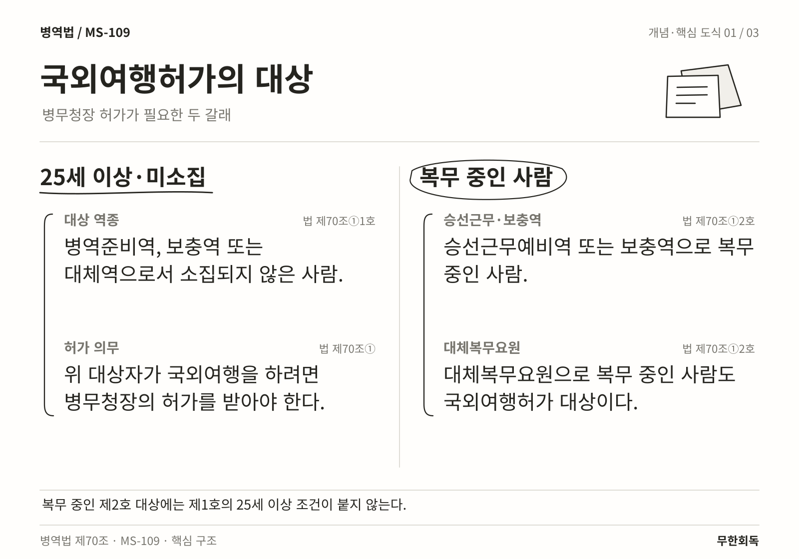
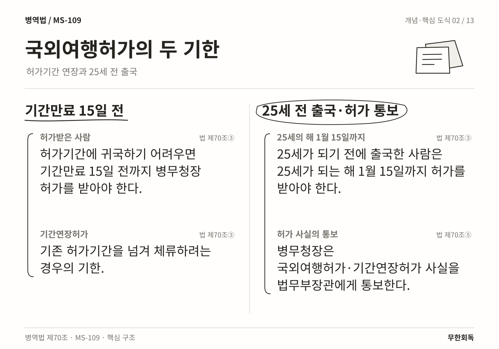
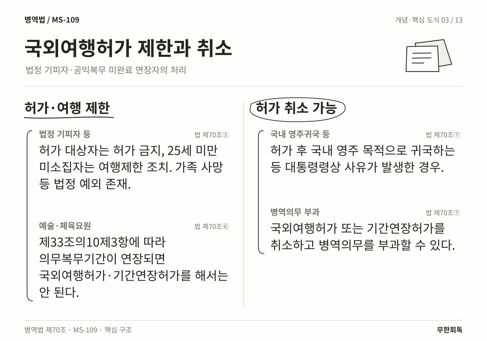
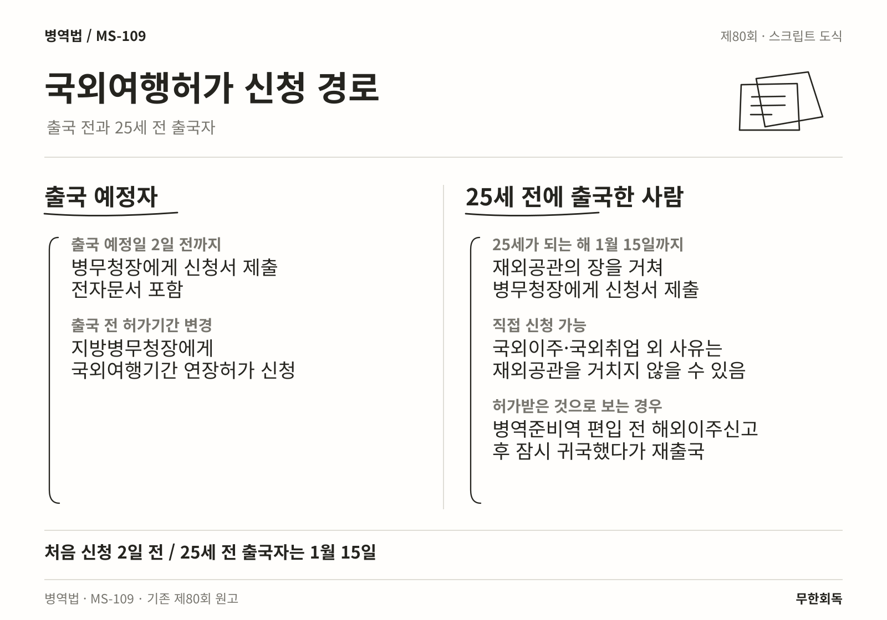
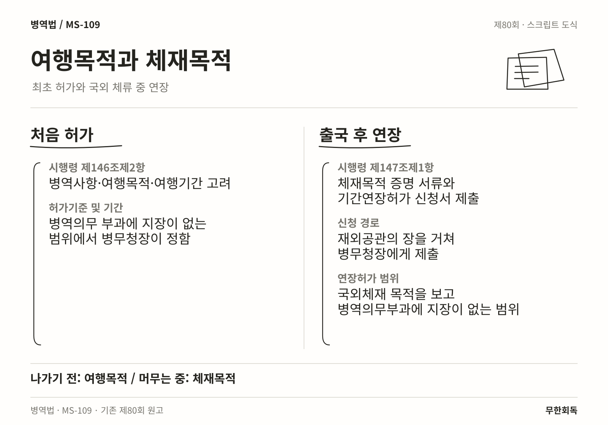
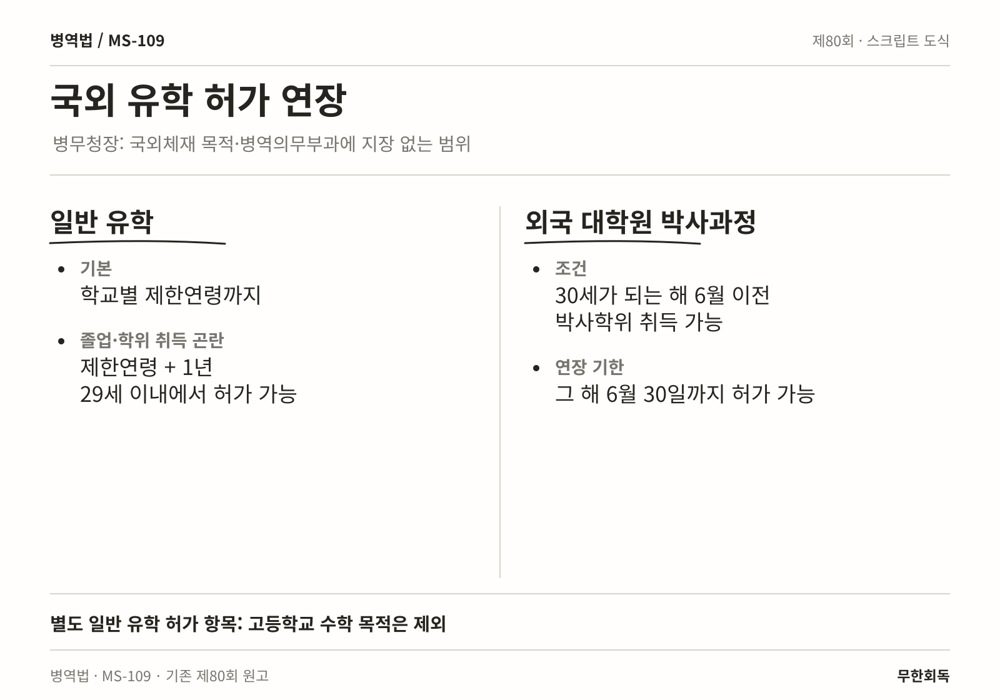
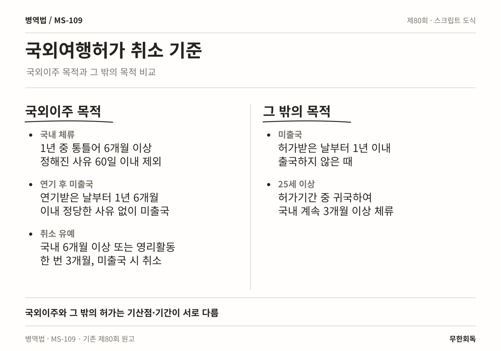
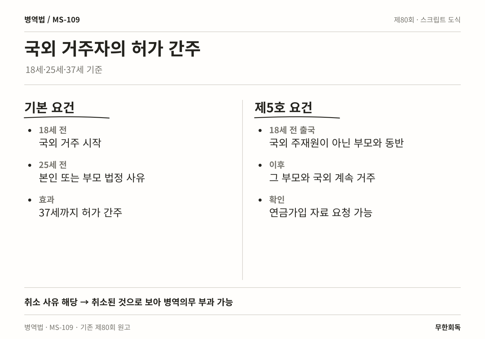

# MS-109 · 병역법 제70조, 국외여행의 허가 및 취소

흑백 편집형 도식 8장 · 1600×1120 · SVG / 무손실 WebP

## 01. 국외여행허가의 대상

[강의용 WebP](MS-109-D01-editorial-v1.webp) · [편집용 SVG](MS-109-D01-editorial-v1.svg)

## 02. 국외여행허가의 두 기한

[강의용 WebP](MS-109-D02-editorial-v1.webp) · [편집용 SVG](MS-109-D02-editorial-v1.svg)

## 03. 국외여행허가 제한과 취소

[강의용 WebP](MS-109-D03-editorial-v1.webp) · [편집용 SVG](MS-109-D03-editorial-v1.svg)

## 04. 국외여행허가 신청 경로

[강의용 WebP](MS-109-D04-editorial-v1.webp) · [편집용 SVG](MS-109-D04-editorial-v1.svg)

## 05. 여행목적과 체재목적

[강의용 WebP](MS-109-D05-editorial-v1.webp) · [편집용 SVG](MS-109-D05-editorial-v1.svg)

## 06. 국외 유학 허가 연장

[강의용 WebP](MS-109-D06-editorial-v1.webp) · [편집용 SVG](MS-109-D06-editorial-v1.svg)

## 07. 국외여행허가 취소 기준

[강의용 WebP](MS-109-D07-editorial-v1.webp) · [편집용 SVG](MS-109-D07-editorial-v1.svg)

## 08. 국외 거주자의 허가 간주

[강의용 WebP](MS-109-D08-editorial-v1.webp) · [편집용 SVG](MS-109-D08-editorial-v1.svg)

[전체 병역법 도식 목차](../../README.md)
