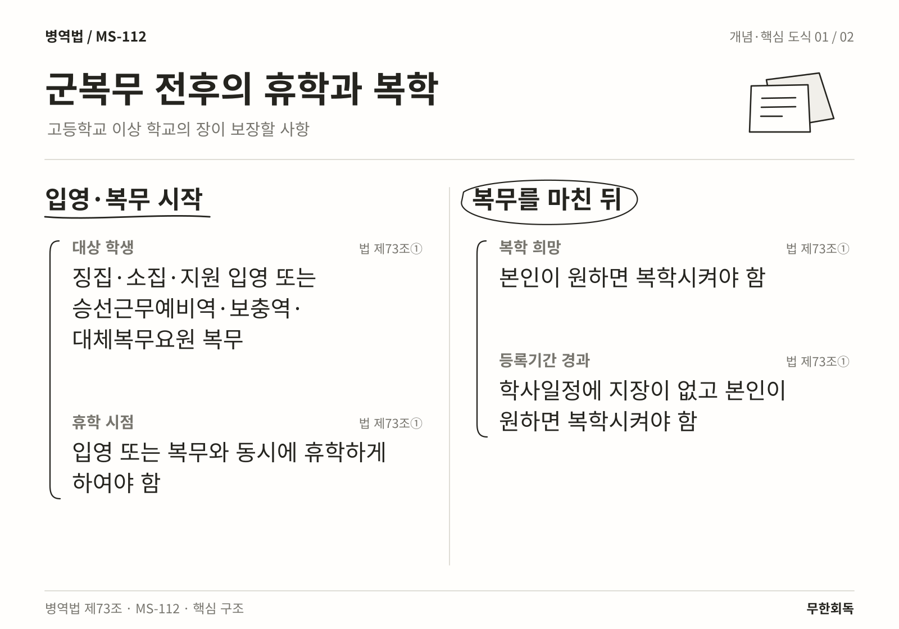
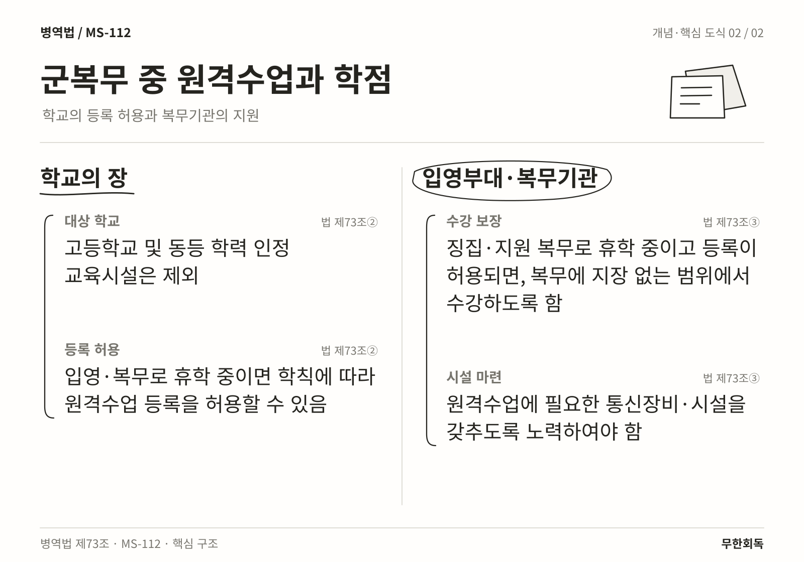

# MS-112 · 병역법 제73조, 복학보장 및 군복무 중 학점취득 인정

흑백 편집형 도식 2장 · 1600×1120 · SVG / 무손실 WebP

## 01. 군복무 전후의 휴학과 복학

[강의용 WebP](MS-112-D01-editorial-v1.webp) · [편집용 SVG](MS-112-D01-editorial-v1.svg)

## 02. 군복무 중 원격수업과 학점

[강의용 WebP](MS-112-D02-editorial-v1.webp) · [편집용 SVG](MS-112-D02-editorial-v1.svg)

[전체 병역법 도식 목차](../../README.md)
