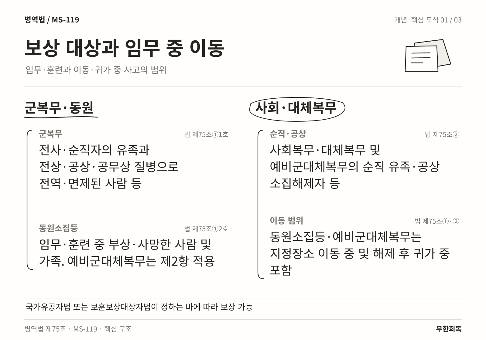
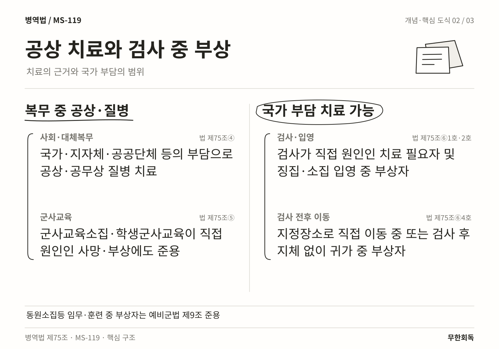
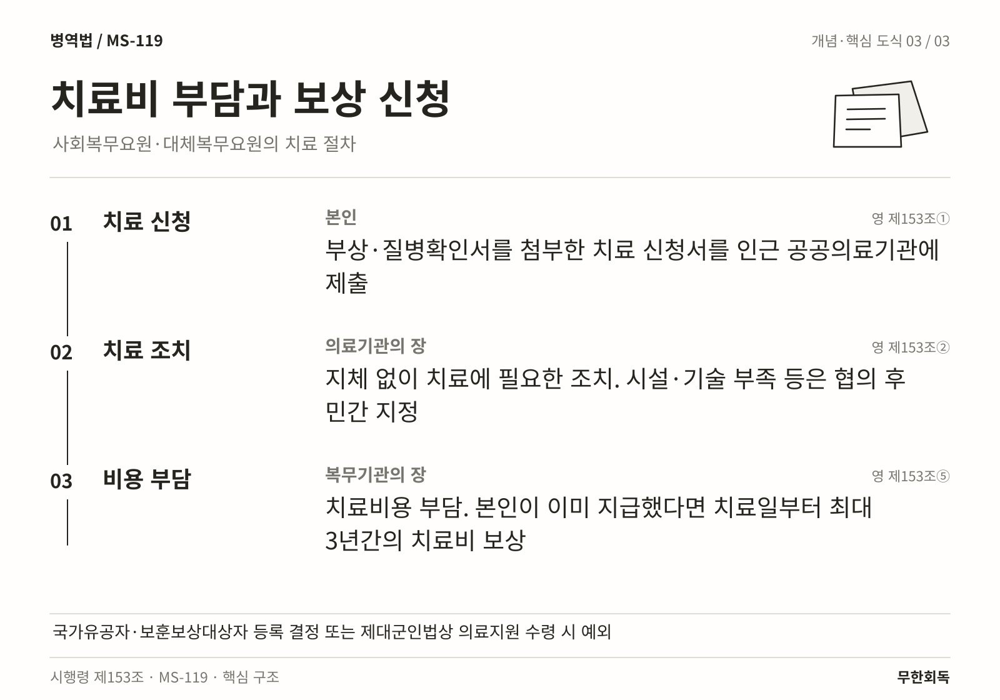

# MS-119 · 병역법 제75조, 보상 및 치료

흑백 편집형 도식 3장 · 1600×1120 · SVG / 무손실 WebP

## 01. 보상 대상과 임무 중 이동

[강의용 WebP](MS-119-D01-editorial-v1.webp) · [편집용 SVG](MS-119-D01-editorial-v1.svg)

## 02. 공상 치료와 검사 중 부상

[강의용 WebP](MS-119-D02-editorial-v1.webp) · [편집용 SVG](MS-119-D02-editorial-v1.svg)

## 03. 치료비 부담과 보상 신청

[강의용 WebP](MS-119-D03-editorial-v1.webp) · [편집용 SVG](MS-119-D03-editorial-v1.svg)

[전체 병역법 도식 목차](../../README.md)
