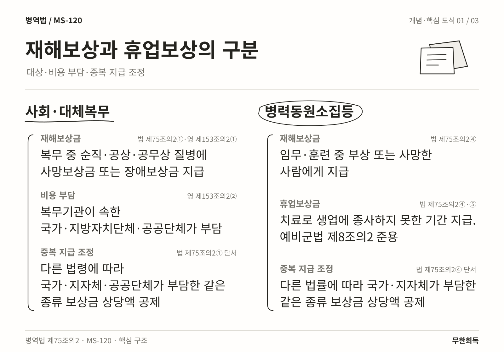
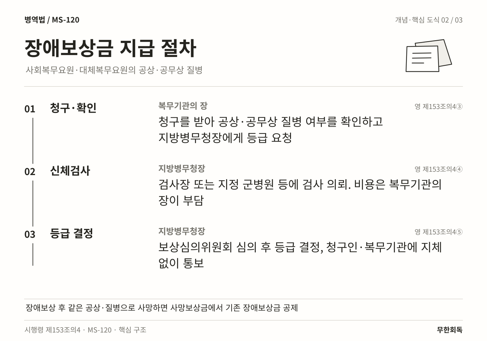
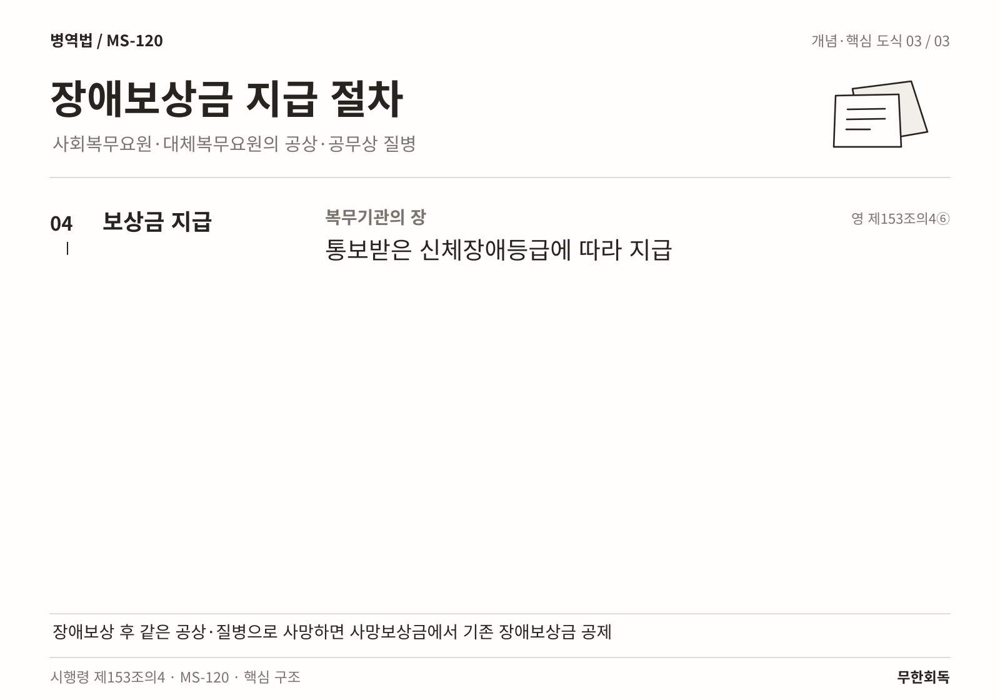

# MS-120 · 병역법 제75조의2, 재해 등에 대한 보상

흑백 편집형 도식 3장 · 1600×1120 · SVG / 무손실 WebP

## 01. 재해보상과 휴업보상의 구분

[강의용 WebP](MS-120-D01-editorial-v1.webp) · [편집용 SVG](MS-120-D01-editorial-v1.svg)

## 02. 장애보상금 지급 절차

[강의용 WebP](MS-120-D02-editorial-v1.webp) · [편집용 SVG](MS-120-D02-editorial-v1.svg)

## 03. 장애보상금 지급 절차

[강의용 WebP](MS-120-D03-editorial-v1.webp) · [편집용 SVG](MS-120-D03-editorial-v1.svg)

[전체 병역법 도식 목차](../../README.md)
