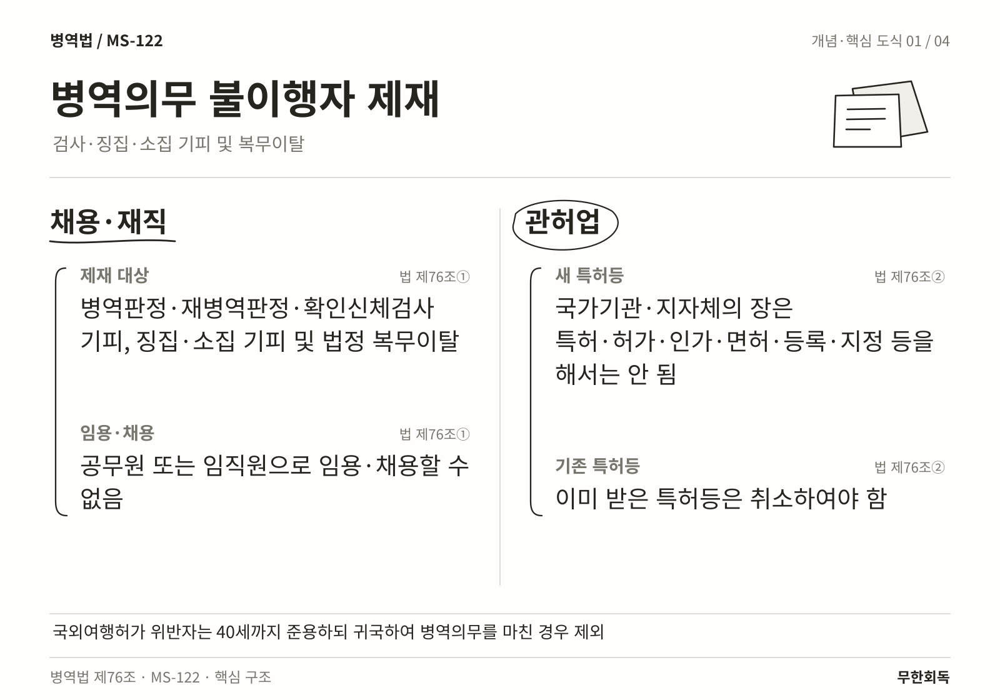
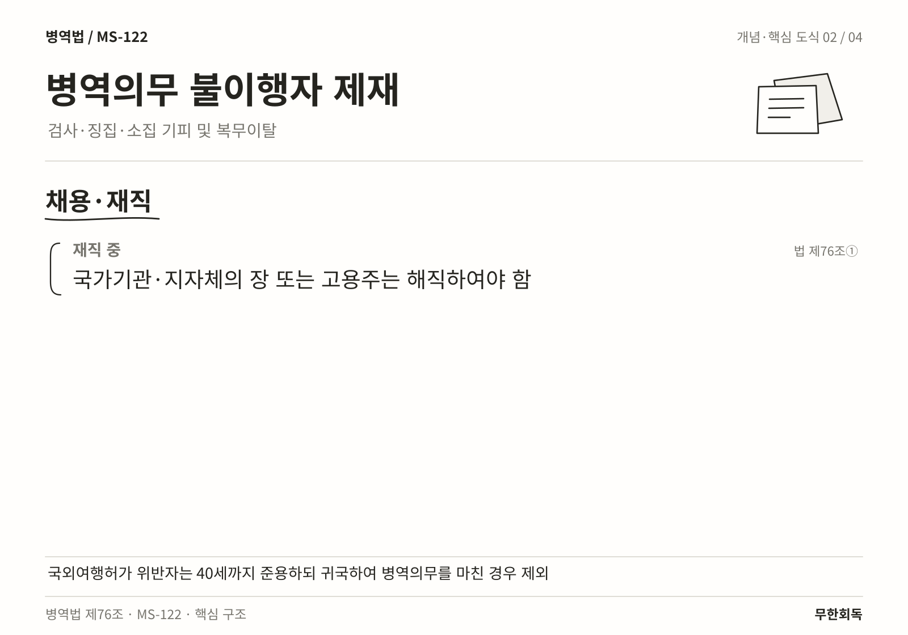
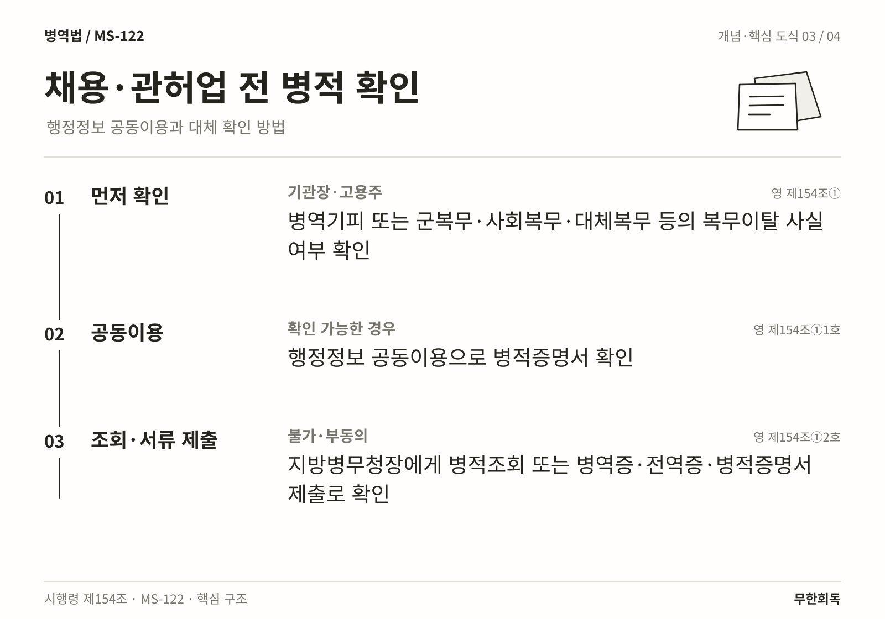
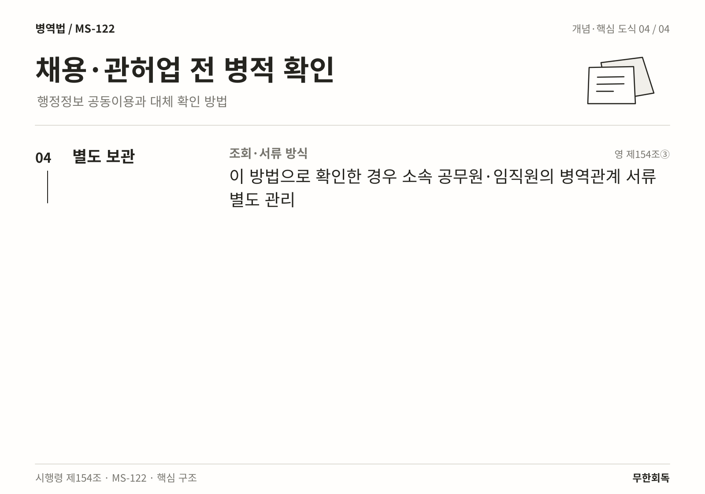

# MS-122 · 병역법 제76조, 병역의무 불이행자에 대한 제재

흑백 편집형 도식 4장 · 1600×1120 · SVG / 무손실 WebP

## 01. 병역의무 불이행자 제재

[강의용 WebP](MS-122-D01-editorial-v1.webp) · [편집용 SVG](MS-122-D01-editorial-v1.svg)

## 02. 병역의무 불이행자 제재

[강의용 WebP](MS-122-D02-editorial-v1.webp) · [편집용 SVG](MS-122-D02-editorial-v1.svg)

## 03. 채용·관허업 전 병적 확인

[강의용 WebP](MS-122-D03-editorial-v1.webp) · [편집용 SVG](MS-122-D03-editorial-v1.svg)

## 04. 채용·관허업 전 병적 확인

[강의용 WebP](MS-122-D04-editorial-v1.webp) · [편집용 SVG](MS-122-D04-editorial-v1.svg)

[전체 병역법 도식 목차](../../README.md)
