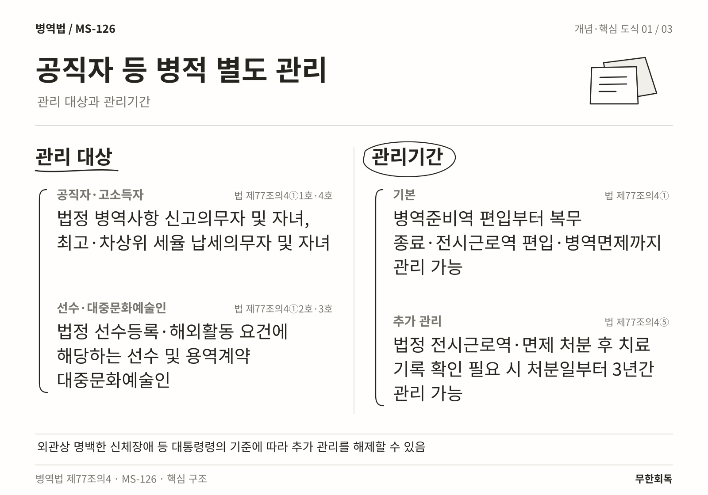
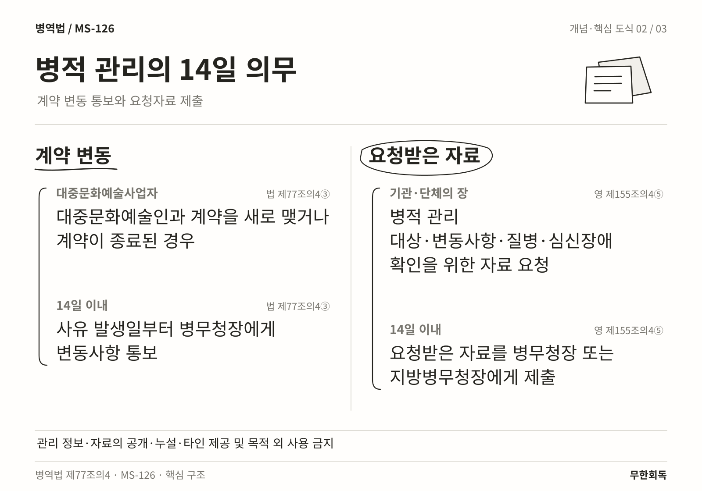
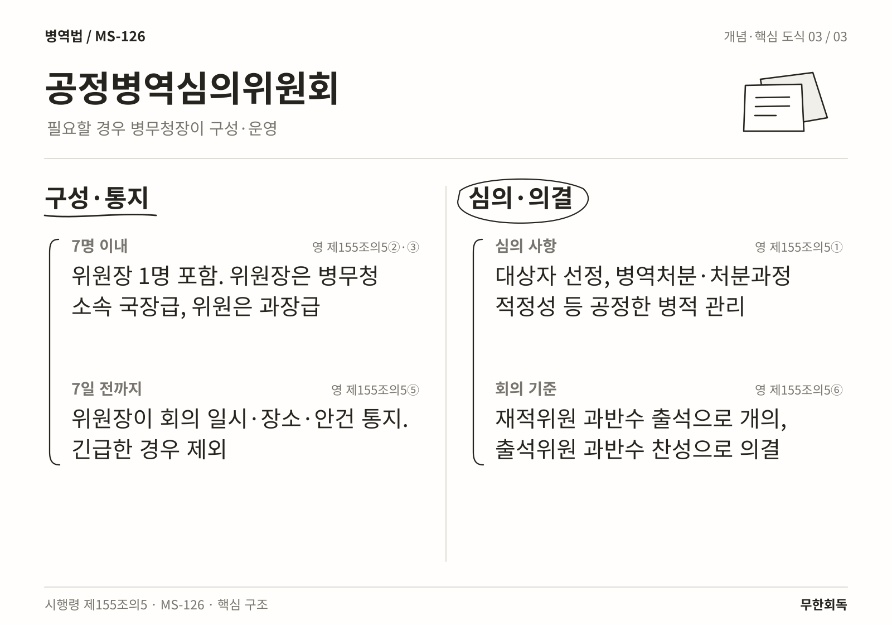

# MS-126 · 병역법 제77조의4, 공직자 등의 병적 관리 등

흑백 편집형 도식 3장 · 1600×1120 · SVG / 무손실 WebP

## 01. 공직자 등 병적 별도 관리

[강의용 WebP](MS-126-D01-editorial-v1.webp) · [편집용 SVG](MS-126-D01-editorial-v1.svg)

## 02. 병적 관리의 14일 의무

[강의용 WebP](MS-126-D02-editorial-v1.webp) · [편집용 SVG](MS-126-D02-editorial-v1.svg)

## 03. 공정병역심의위원회

[강의용 WebP](MS-126-D03-editorial-v1.webp) · [편집용 SVG](MS-126-D03-editorial-v1.svg)

[전체 병역법 도식 목차](../../README.md)
