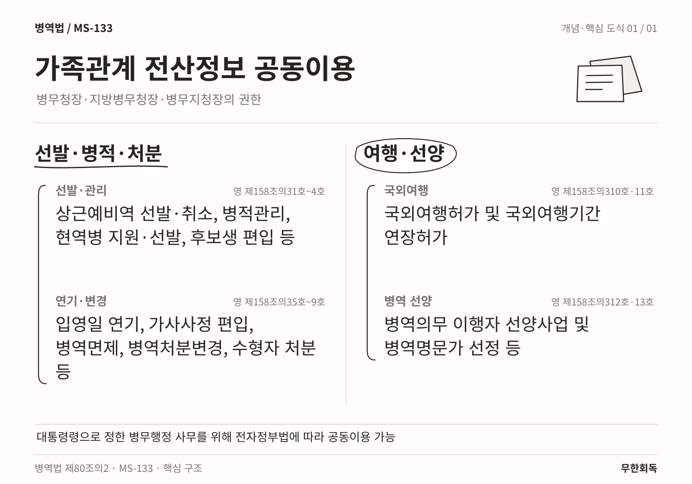

# MS-133 · 병역법 제80조의2, 가족관계등록 전산정보의 공동이용

흑백 편집형 도식 1장 · 1600×1120 · SVG / 무손실 WebP

## 01. 가족관계 전산정보 공동이용

[강의용 WebP](MS-133-D01-editorial-v1.webp) · [편집용 SVG](MS-133-D01-editorial-v1.svg)

[전체 병역법 도식 목차](../../README.md)
