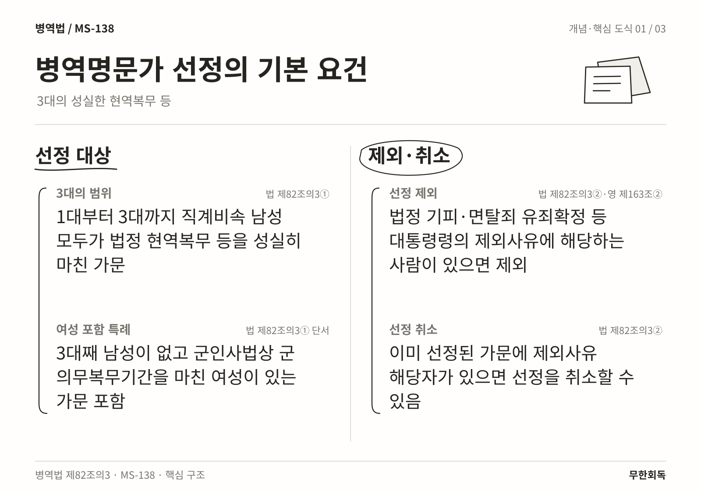
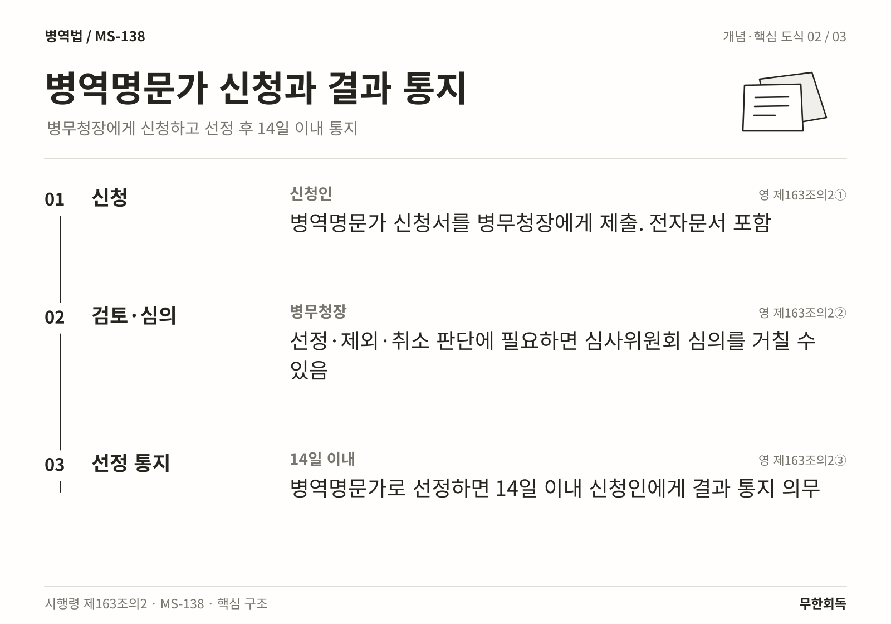
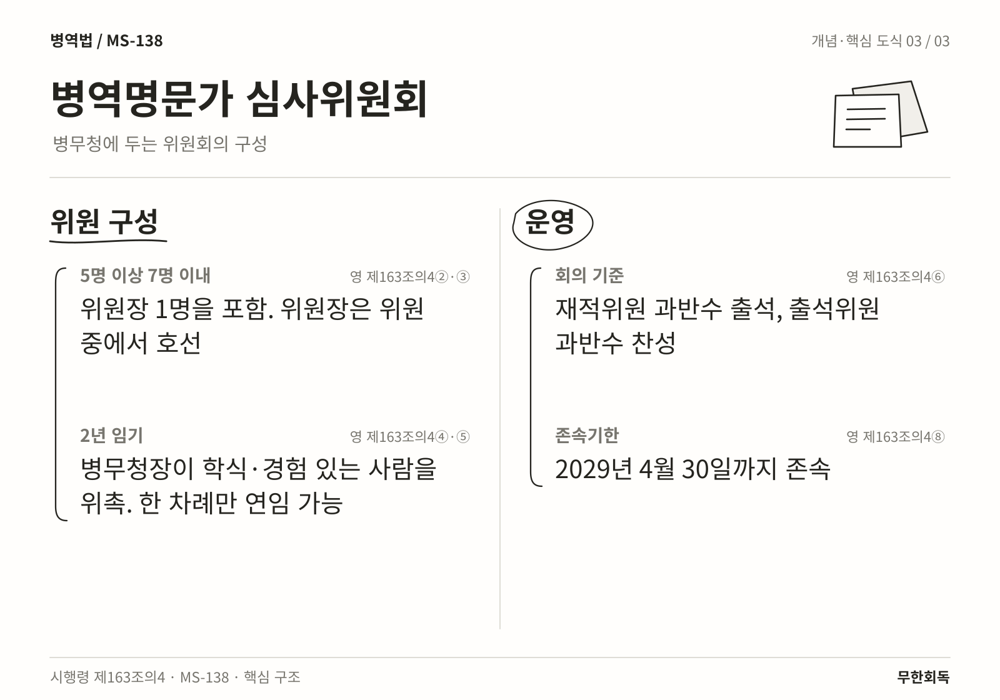

# MS-138 · 병역법 제82조의3, 병역명문가 선정 등

흑백 편집형 도식 3장 · 1600×1120 · SVG / 무손실 WebP

## 01. 병역명문가 선정의 기본 요건

[강의용 WebP](MS-138-D01-editorial-v1.webp) · [편집용 SVG](MS-138-D01-editorial-v1.svg)

## 02. 병역명문가 신청과 결과 통지

[강의용 WebP](MS-138-D02-editorial-v1.webp) · [편집용 SVG](MS-138-D02-editorial-v1.svg)

## 03. 병역명문가 심사위원회

[강의용 WebP](MS-138-D03-editorial-v1.webp) · [편집용 SVG](MS-138-D03-editorial-v1.svg)

[전체 병역법 도식 목차](../../README.md)
