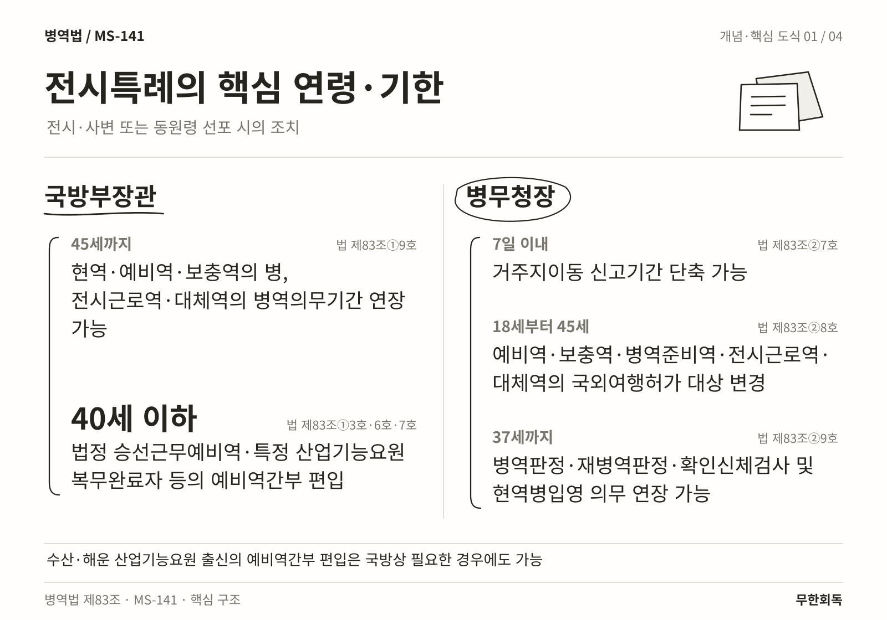
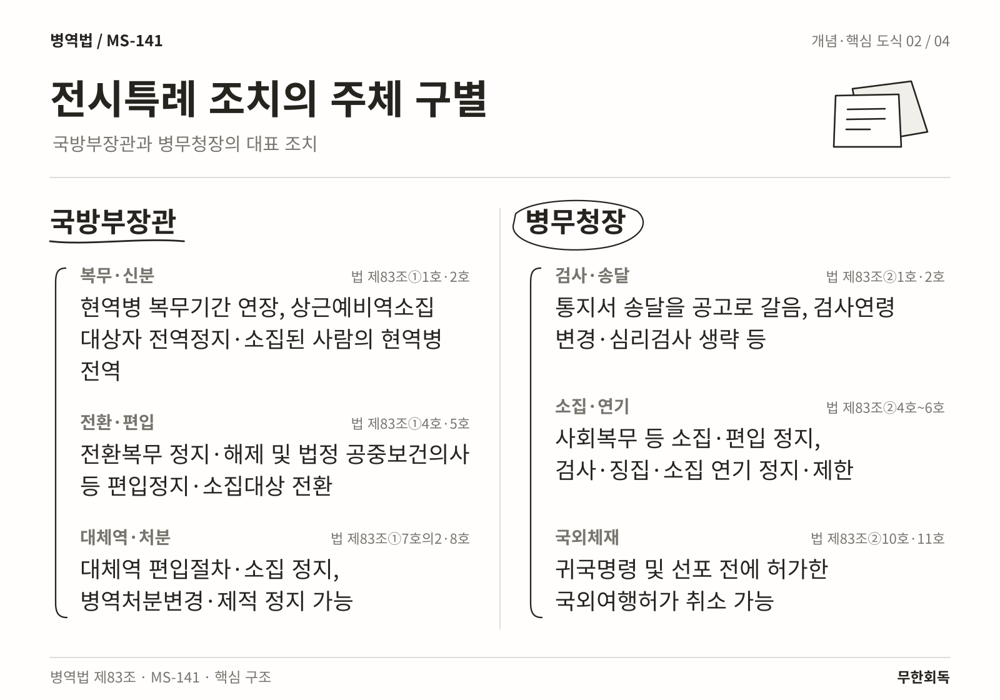
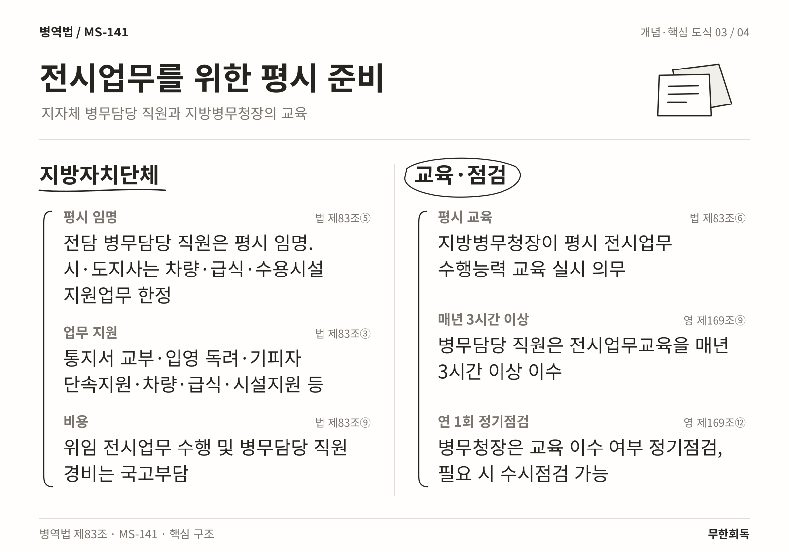
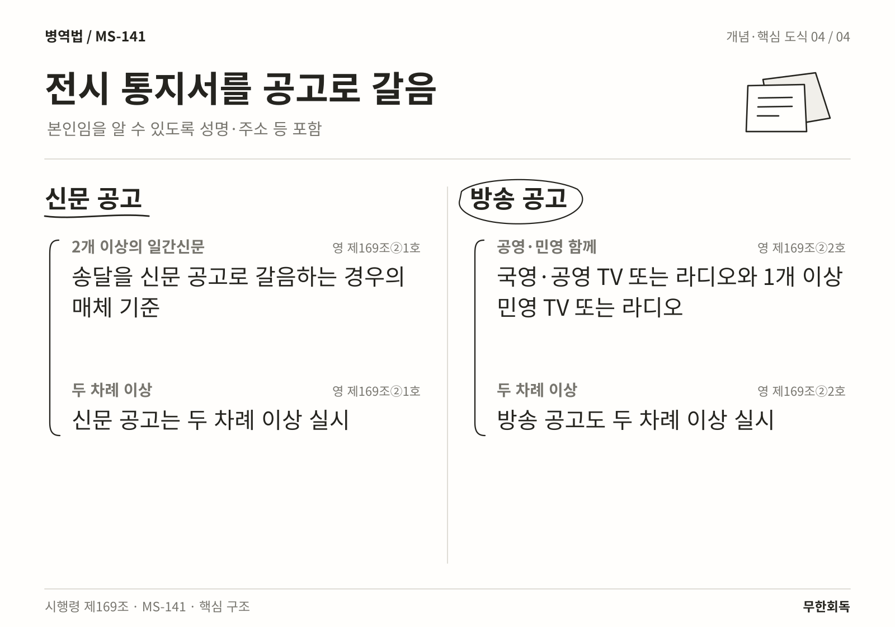

# MS-141 · 병역법 제83조, 전시특례

흑백 편집형 도식 4장 · 1600×1120 · SVG / 무손실 WebP

## 01. 전시특례의 핵심 연령·기한

[강의용 WebP](MS-141-D01-editorial-v1.webp) · [편집용 SVG](MS-141-D01-editorial-v1.svg)

## 02. 전시특례 조치의 주체 구별

[강의용 WebP](MS-141-D02-editorial-v1.webp) · [편집용 SVG](MS-141-D02-editorial-v1.svg)

## 03. 전시업무를 위한 평시 준비

[강의용 WebP](MS-141-D03-editorial-v1.webp) · [편집용 SVG](MS-141-D03-editorial-v1.svg)

## 04. 전시 통지서를 공고로 갈음

[강의용 WebP](MS-141-D04-editorial-v1.webp) · [편집용 SVG](MS-141-D04-editorial-v1.svg)

[전체 병역법 도식 목차](../../README.md)
