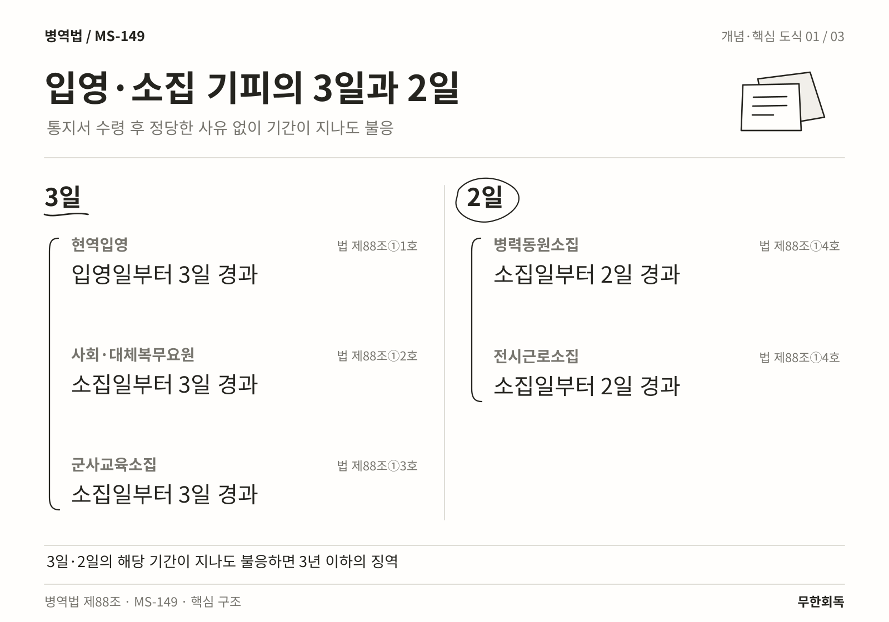
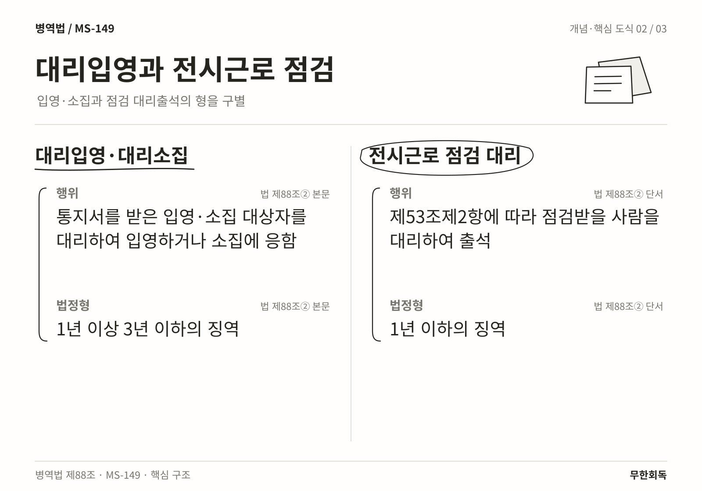
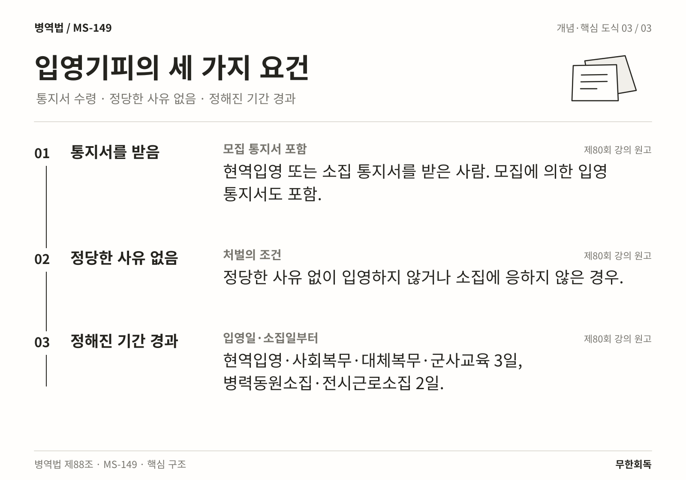

# MS-149 · 병역법 제88조, 입영의 기피 등

흑백 편집형 도식 3장 · 1600×1120 · SVG / 무손실 WebP

## 01. 입영·소집 기피의 3일과 2일

[강의용 WebP](MS-149-D01-editorial-v1.webp) · [편집용 SVG](MS-149-D01-editorial-v1.svg)

## 02. 대리입영과 전시근로 점검

[강의용 WebP](MS-149-D02-editorial-v1.webp) · [편집용 SVG](MS-149-D02-editorial-v1.svg)

## 03. 전시근로소집 대비 점검 불참

[강의용 WebP](MS-149-D03-editorial-v1.webp) · [편집용 SVG](MS-149-D03-editorial-v1.svg)

[전체 병역법 도식 목차](../../README.md)
