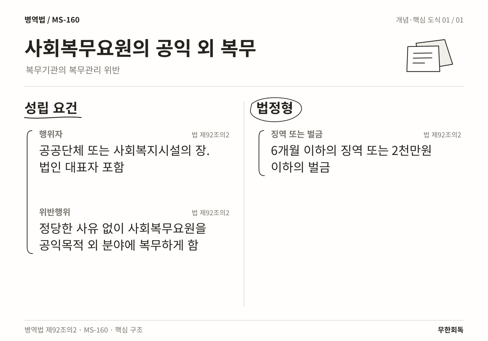

# MS-160 · 병역법 제92조의2, 복무기관의 복무관리 위반

흑백 편집형 도식 1장 · 1600×1120 · SVG / 무손실 WebP

## 01. 사회복무요원의 공익 외 복무

[강의용 WebP](MS-160-D01-editorial-v1.webp) · [편집용 SVG](MS-160-D01-editorial-v1.svg)

[전체 병역법 도식 목차](../../README.md)

## 제80회 기존 원고 대조
원고 전문 및 공개 도식 검수 완료 — 기존 도식 재사용. 추가 제작 없음.

[대조 근거](../../production-evidence/exam80-generation-2/MS-160/001-4fd667774affd36c7216d777d3ad815292381f91e737a95b7cda1efaa973b98c.json) · 관련 도식: [MS-144-D01-editorial-v1](../../lesson-144/diagrams/)
